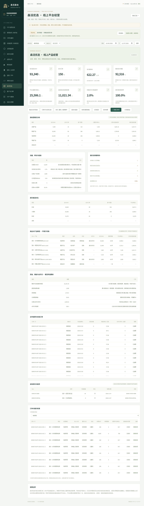

# 森活优选 · 商品与线上平台经营（v1.7）

独立记录森活优选的商品、自营、联营、电商带货、零售及其他合作；支持实物、券类权益、服务和其他商品形态。它是CEO驾驶舱中的平台经营模块，使用真实数据库持久化、角色/项目授权、原始来源下钻和现有CSV/XLSX导入流程。

项目代码`youxuan`、经营类型`commerce`；实际空间只增加用户要求的项目背景，不生成真实订单、合同、佣金或费用。独立演示样例有明确DEMO标识。芳疗项目的当前名称统一为“芳疗SPA”，升级保留原项目代码、权限、业务关联和其他配置；迁移只执行一次，保留审计，不复活用户随后删除的项目。

## 专业指标与收入边界

| 内容 | 口径与来源 |
|---|---|
| 支付GMV | 期间客户真实支付事件合计，商家直收也可记录；不是平台收入 |
| 支付订单/客单 | 支付订单按项目与订单号去重，多商品行不重复算订单；GMV除以支付订单数 |
| 支付净额 | 期间客户支付减期间客户退款，退款可能来自以前的订单，不称同批退款率 |
| 平台已履约净收入 | 全额合同按实际交付/核销收入；净额合同按已核实佣金/服务费；扣明确收入冲回 |
| 经营贡献 | 平台净收入减直接/公共费用与结算扣费；相关订单行直接成本及各日平台费用均已财务确认，才输出贡献，不称法定净利润 |
| 同批订单退款率 | 所选期间发生过支付的订单中，截至期末已发生退款的订单比例，按订单去重 |
| 准时发货率 | 已到约定发货期限的物流订单行中，按时足量发货比例；取消未履约数量单列，自提/核销/服务不套物流分母 |
| 访问批次支付转化 | 同一日/渠道访问批次的支付人数除访客数，按批次加权；窗口完整才显示。日渠道UV合计不冒充跨日去重人数 |
| 广告ROAS | 有匹配活动代码的付费成交额除实际登记活动花费，未知归因保留未知，不用全平台GMV除广告费冒充投产，不等同利润ROI |
| 商品表现 | SKU、品类、经营模式、合作方、支付GMV、履约数量、平台收入与已核对直接贡献 |
| 库存与动销 | 当前在售SKU、本期有履约的当前在售SKU占比；只统计声明归平台的实物库存，未登记快照是未知，不填0 |
| 结算 | 截至期末渠道待结算、待收佣金、已收需退佣金、已登记合作方待付和退款后待追偿；历史未结订单不会因选最近期间消失 |

自营、零售是否按全额销售，联营是否按净额佣金，均以实际合同和主要责任判断为准；经营模式和收入确认方式分别记录，不强行把所有联营都认作佣金。带货不能把商家GMV全额认作平台收入。合同未确认或净额佣金未核实，收入保留未知。

客户支付、物流发货、实际交付/核销、收入确认、渠道结算及合作方付款分开。发货不等于收入；售券不等于核销；预付或代收合作方本金不当收入。退款不自动恢复库存或权益份数，需要实际盘点/核销系统支持。

森活优选使用独立台账；其GMV不再次加入园区交易额或园区履约收入。订单行可以关联已经存在的园区项目/订单，供对账使用，不自动再造一笔酒店收入。平台与运营公司或集团的正式合并，须按实际经营主体、合同及内部交易核对抵消，不能把各页面金额机械相加。

## 六类采集台账

| 类型 | 填写内容 |
|---|---|
| commerce_product | SKU、产品名称、品类、当前模式、形态、合作方、库存归属、参考价与负责人 |
| commerce_line | 订单与商品行、成交时模式、金额/数量、取消未履约数量、成交渠道/活动、合同收入方式、收款方、履约方式、发货及结算日期、匿名客户和园区关联 |
| commerce_event | 支付、退款、发货、交付/核销、净佣金确认、结算及扣费、佣金收退、合作方应付/冲回/付款和原始凭证 |
| commerce_cost | 已登记商品实际销售成本、物流、包材、投放、达人、服务、售后和其他费用；可关联订单行或保留未分摊公共费用 |
| commerce_traffic | 平台级或产品级的日渠道访问批次、UV、同批支付人数、观察截止与完整性；产品级不重复加到平台UV |
| commerce_stock | SKU与仓库的实物、锁定、不可售及最近出库快照；商家自有库存不能记作平台库存 |

沿用`coverage`做逐日费用完整性确认，订单行`cost_complete`表示该行直接成本已核对。收退款、资金结算及完整性由财务确认；主管可登记发货、交付事实，线上运营维护商品、未核定订单、访问批次和库存，不因此获得财务明细权限。

各台账提供`templates/commerce_*.csv`及通用Excel模板。先录商品，再录订单行，再录实际事件、成本、流量及库存。订单行保留成交时模式和合同口径，后续目录改名不会悄悄重算历史模式。金额不用参考价估算，没有实际佣金也不预设比例。

重复导入按稳定外部编号跳过，内容改变须显式编辑并留版本/审计；订单行、同来源同订单行事件、成本来源、日渠道访问批次及库存快照有业务键校验。累计支付、退款、数量、收入冲回、结算本金及扣费、佣金到账、合作方付款均核验关联和上限。

## 照片费用与自动化

员工可继续在森活优选项目拍单据，由本地OCR读取并保留原件；财务确认为实际费用后写入`commerce_cost`，不会混进园区成本。采购入库/资产/付款凭证仍先归档，不自动当作销售成本；结算扣费只在结算事件记录一次，别再录一笔相同费用。

真实自动化需商城/抖店/小程序等商家授权、订单行和支付退款、物流签收或权益核销、合作方佣金与结算、投放批次、ERP/库存等实际接口。当前有受控签名接入入口及导入，不宣称已经接通这些平台。

