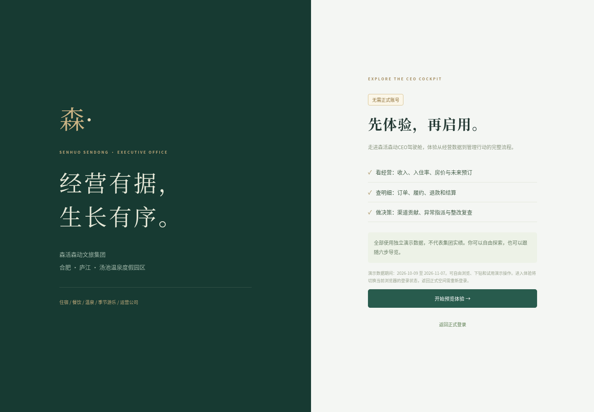

# 预览体验 · v1.4

**在线只读体验**：https://zhangheng060125.github.io/CEO-jiashicang/?v=1.4.0 。支持模块浏览、酒店/期间筛选、订单下钻和模板下载；录入和整改保存需运行下文的完整版后台。原GitHub Pages资源路径和后台接口问题已修复，详见 [静态体验说明](github-pages.md)。

以下为运行完整版后台时的演示功能。

部署并启动后，登录页点击「预览体验 · 免账号进入」，或打开该部署的 `/preview` 路径，再点击「开始预览体验」。正式登录后的页头也有「预览体验」入口。GitHub仓库和截图不是可交互网站地址。

## 体验内容

约三分钟六步导览：经营全貌 → 订单追溯 → 未来房态 → 渠道贡献 → 财务结算 → 异常整改。可以点击「体验路线」直接选择步骤，随时切换原有业务模块、酒店与日期，并试用演示录入、导入和整改。

订单步骤可打开一笔有履约收入的示例订单，展示原始记录；异常步骤可选择预警并实际指派整改。导览只负责导航和讲解，不代替用户保存业务记录。

演示日期、房量、合同费率、经营数据和问题均为模拟，不代表集团实绩。默认统计期间为演示库最近履约日及之前29天，未来房态和结算账期以该演示基准日起算；页面会明确标注。修改统计区间不会改变真实经营口径。

「恢复默认视图」恢复默认日期、全域范围与导览第一步，不删除或重建任何演示记录。导览进度仅在当前浏览器标签会话中保存；业务记录仍在后端SQLite。演示空间由体验者共享，不是每人一份独立副本。

「结束体验」注销演示会话并返回体验入口。演示会话由后端限制，只能访问demo，不能访问实际数据、管理正式账号或创建接入凭证。进入体验会切换当前浏览器登录状态，返回正式空间需重新登录。

## 启用与关闭

- `HOTEL_ALLOW_DEMO=1`：开放免账号预览。项目开发默认启用；现有生产配置生成器默认设0，需要开放体验的部署应明确修改该变量并重启。
- `HOTEL_ALLOW_DEMO=0`：隐藏登录页和正式页头的体验入口；`/preview` 显示当前未开放，服务端拒绝演示登录。不会因此开放真实数据。
- `bash scripts/setup.sh` 已包含幂等演示初始化；也可由部署管理者运行 `python seed_demo.py` 和 `python seed_extensions.py`。缺少演示订单时入口提示未准备并禁用开始按钮，页面访问不会自动写入或重置数据库。

`/api/preview-info` 是公开的只读配置接口，仅在启用时返回演示准备状态、推荐日期及基准日，不返回订单、真实数据或账户信息。

## 验证

`npm test` 包含预览公开入口、只读元信息、禁用开关及真实数据越权检查。`python tests/browser_preview.py` 在临时数据库验证六步导览、示例订单下钻、预警指派、刷新进度、恢复视图保留记录、手机布局、退出及重新正式登录，并比对实际数据完全未变化。
