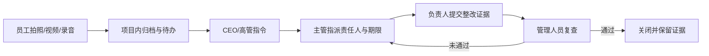
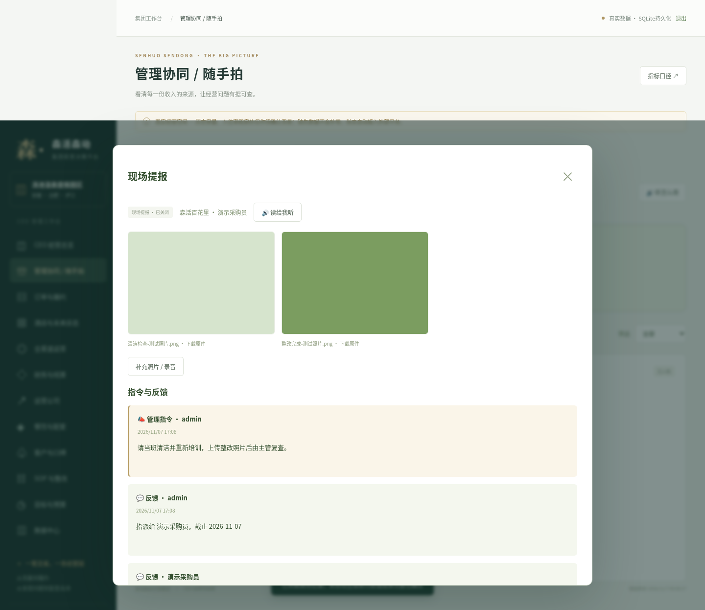
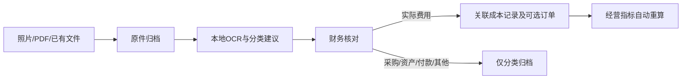
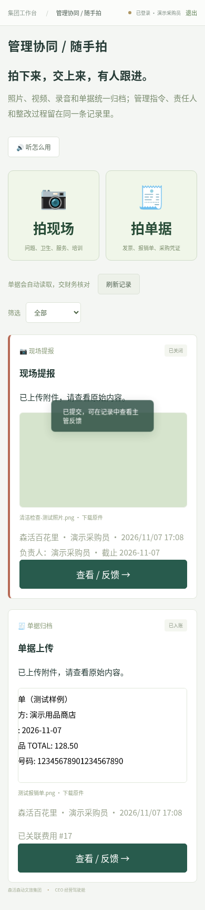

# 管理协同、随手拍与单据识别 · v1.5

目标是让员工只负责「拍下来或说一句」，由管理人员跟进、财务确认，系统保留原件和过程。员工不需要做Excel，也不需要先理解经营指标。当前网站的演示入口为 https://zhangheng060125.github.io/CEO-jiashicang/?v=1.5.0&capture=1 ，实际上传和保存使用部署后的完整版后台。

## 一、现场监督与管理互动

员工、餐厅监管及培训人员在「管理协同 / 随手拍」选择「拍现场」，上传照片、视频或录音，文字可以不填。资料归属员工被授权的项目；如果只授权一家店，会自动使用该店。

CEO和高管可以查看授权范围内的提报，并在原记录内发布管理指令。中层/店长可以指派负责人、期限、部门和严重性。负责人补充整改照片、录音或说明，管理人员复查通过后关闭，或退回继续整改。红线不能降级、不能自行复查通过，原始证据不能通过普通整改表删除。



首页显示当前授权范围的现场待办、单据待确认、未关闭红线。协同空间不随经营报表日期隐藏历史未结事项，支持按项目及类型查看；未关闭红线优先，超过100条可继续加载。页面打开时约每20秒检查是否有变化；没有变化不会反复重载照片。它不代表已经发送短信、微信或其他外部通知。



## 二、员工拍单据，系统读取并归档

在「拍单据」中拍发票、报销单、采购凭证，或选择已有PDF/xlsx文件；可附录音说明用途，不要求打字。一次提交一张单据，同一单据多页可一起上传。原件先保存，后台两路排队读取，员工不用留在页面等识别；待处理状态在数据库中保留，服务重新启动后会继续处理未完成任务。

本地OCR提取金额、日期、商家、票号并提供单据性质/费用科目建议。原文字和识别建议保留供核对，缺失不会补0。识别失败时原件仍在，可补拍、重试或人工核对。当前采用本机Tesseract中文/英文模型，不把票据传给外部AI服务，也没有声称接通未配置的大模型。

财务在同一条记录中处理：

| 确认性质 | 处理结果 |
|---|---|
| 实际费用 | 核对金额、归属日期、科目、园区/运营公司及可选订单号；勾选确认后生成一笔可追溯成本 |
| 采购入库 | 确认归档，不把采购金额直接扣成当日食材耗用或经营费用 |
| 资产资料 | 确认归档，不自动当作当日费用或编造折旧 |
| 付款凭证 | 确认归档，不把付款重复当作费用、酒店收款或收入 |
| 其他资料 | 确认归档，不自动生成财务金额 |

财务确认归档后不再作为未处理单据持续提醒。系统保留操作人、时间和反馈。识别不会自动新增收付款流水，也不会自动勾选「全部成本完整」。费用确认按原件SHA-256及已确认票号防重复，并阻止同一单据跨项目重复计费；共同费用须先由财务核对真实分摊，不给每店重复记全额。



语音目前用于留存和回放，不自动转写为会计数据；照片/视频也不会自动给员工判责。模糊、手写、复杂或多张混合票据可能需要人工核对，不能仅凭一张发票证明已经付款、已经耗用或已发生服务。

## 三、适合老龄员工的使用方式

1. 管理员创建「员工 / 巡检 / 采购」账号并绑定酒店。主管协助首次登录该系统的 `/capture`；员工专用手机可选择保持登录30天。停用、改密码或修改授权仍会注销旧会话。
2. 把入口放到手机桌面。员工界面只显示随手拍，大按钮可直接打开相机、相册、视频或录音，不需要填报表。
3. 有「听怎么用」及记录朗读按钮。不会打字可以录音；完全不会操作手机时由主管/班组数据员代拍代传，系统如实记录实际上传人，可用录音说明代谁提交。



相机、录音和朗读支持取决于手机/浏览器；真实手机录音需要HTTPS和设备授权。网页录音不可用时可以上传系统录音文件。每次最多5个附件、单个64MB，视频/录音不超过5分钟，建议短视频30秒内。支持常见图片、HEIC、PDF、普通xlsx、MP4/WebM/MOV及常用录音。含宏Excel、网页和可执行文件拒绝上传；公式不执行。

手机照片提供适合浏览的压缩预览，HEIC提供JPEG预览；部分MOV/HEVC视频提供MP4预览。原文件不被替换，可单独下载并按保存的哈希核对。PDF识别最多前3页；xlsx读取最多前3个工作表、每表300行25列，复杂明细仍应通过原有结构化导入或业务系统接口处理。

## 四、角色与资料范围

| 角色 | 协同权限 |
|---|---|
| CEO / 集团管理者 | 授权范围内全部提报、管理指令、指派、复查及财务确认；管理账号和项目权限 |
| 高管 / 区域负责人 | 指定多个项目内查看与发指令、指派、复查；不因此获得账号管理或财务写入权限 |
| 中层 / 店长 | 本项目资料、反馈、指派和复查；不能冒充CEO/高管的指令身份 |
| 财务 | 授权项目的单据读取、核对、分类归档与费用确认；现场提报仅本人或被指派时可见 |
| 员工 / 巡检 / 采购 | 上传，查看本人及被指派记录、反馈和整改；不能看经营报表、别人的票据或正式账户管理 |

权限由后端执行。附件需要登录及相应项目/记录权限，不能凭一条公开文件网址访问。真实原件、中文模型及数据库放在私有运行目录，不发布到GitHub；只读网站只使用全新隔离库生成的演示示意图。

## 五、部署与本机识别

安装Python依赖使用 `bash scripts/setup.sh`。操作系统需提供 `tesseract`、`ffprobe/ffmpeg` 和 `pdftotext/pdftoppm`；Linux部署可由服务器管理者安装tesseract-ocr、ffmpeg、poppler-utils。HEIC解码依赖已固定在requirements中。

`python scripts/setup_ocr.py` 将固定版本的官方中文/英文模型安装到 `HOTEL_DATA_DIR/ocr/tessdata`，保留TLS校验并校验Git文件哈希，不需要sudo。setup.sh发现本机tesseract时也会执行模型准备。没有组件时仍可归档，界面会显示识别未准备，不能声称中文识别已就绪。

生产使用独立持久磁盘和HTTPS。附件在 `HOTEL_DATA_DIR/private_media`，目录700、原件600。默认原件配额2048MB，可通过 `HOTEL_MEDIA_QUOTA_MB` 配置；生产配置生成器建议20480MB，并将Nginx上传上限调整为64MB、代理读取超时180秒。磁盘还要容纳预览缓存和备份，容量由正式服务器配置决定。

## 六、备份与恢复

包含附件时使用完整备份，而不是只复制SQLite文件：

```bash
python scripts/backup_full.py /安全备份目录/完整备份.zip
python scripts/restore_full.py /安全备份目录/完整备份.zip /全新恢复目录
```

完整备份含一致性数据库和所有已登记的原件，逐个验证大小及SHA-256；不包含初始明文密码、模型和可再生成的预览缓存。恢复拒绝覆盖已有目录，验证归档路径及文件哈希，清除旧会话并撤销旧接入凭证。有附件时每日备份脚本自动生成完整zip；没有附件时保留旧SQLite备份方式。旧backup.py/restore.py仅处理数据库，不能替代带原件的完整恢复。

## 七、PMS整合仍以真实授权为前提

费用记录可关联已存在的订单号，供现有经营指标和订单明细使用。房态、订单、入住、核销及收退款仍应来自PMS、POS等实际业务源；照片不能替代这些数据。现有受控签名接入入口可供后续适配器使用，但系统名称、供应商授权、字段映射和更新同步尚需确定；本次没有虚构已经自动接通PMS。

GitHub Pages只展示流程和模拟识别结果，明确禁止真实上传、反馈保存及入账。要让员工真实使用，需要将完整版后台部署到可访问的服务器，再给他们该服务器的 `/capture` 地址。
